# Prerequisite graph — roadmap 1.0.0

> Generated by `node scripts/validate-hub.mjs --write` from CURRICULUM_MAP.json. Do not edit by hand.

How to read it: solid arrows are hard prerequisites. Dashed arrows labelled *then* show the recommended study order where it is not also a prerequisite. Dashed arrows labelled *optional* lead to optional branches, which never feed back into the core path. Hexagons are checkpoints and capstones; rounded boxes are optional branches.

```mermaid
graph TD
  subgraph P01["P01 Orientation, quick win and toolchain"]
    P01CH01["P01-CH01 Setup and first 3D quick win"]
    P01CH02["P01-CH02 What the tools do: terminal, Node, npm, Vite, import maps"]
    P01CH03["P01-CH03 Git and GitHub for this course"]
  end
  subgraph P02["P02 JavaScript foundations"]
    P02CH01["P02-CH01 Values, types, operators"]
    P02CH02["P02-CH02 Control flow and functions"]
    P02CH03["P02-CH03 Arrays, objects, references"]
    P02CH04["P02-CH04 Modern syntax and modules"]
    P02CH05["P02-CH05 Classes and error handling"]
    P02CH06["P02-CH06 Events, callbacks, promises, async/await"]
  end
  subgraph P03["P03 Browser foundations"]
    P03CH01["P03-CH01 HTML/CSS to host a canvas"]
    P03CH02["P03-CH02 DOM and UI events"]
    P03CH03["P03-CH03 Animation loop, time, resize"]
    P03CH04["P03-CH04 Debugging web projects"]
    P03CH05{{"P03-CH05 Checkpoint 1: animated 2D explainer card"}}
  end
  subgraph P04["P04 Core Three.js I (with vectors)"]
    P04CH01["P04-CH01 Scene, camera, renderer, loop"]
    P04CH02["P04-CH02 Coordinates and vectors in 3D"]
    P04CH03["P04-CH03 Geometry, mesh, material"]
    P04CH04["P04-CH04 Lights and shadows"]
  end
  subgraph P05["P05 Transforms, rotations and projection"]
    P05CH01["P05-CH01 Angles and trigonometry for motion"]
    P05CH02["P05-CH02 Transforms and the scene graph"]
    P05CH03["P05-CH03 Rotations: Euler angles and quaternions"]
    P05CH04["P05-CH04 Dot and cross products, lookAt"]
    P05CH05["P05-CH05 Matrices and camera projection"]
    P05CH06{{"P05-CH06 Checkpoint 2: solar-system diorama"}}
  end
  subgraph P06["P06 Rendering look: GPU model, colour, materials"]
    P06CH01["P06-CH01 GPU and rasterisation mental model"]
    P06CH02["P06-CH02 Colour management and tone mapping"]
    P06CH03["P06-CH03 Physically based materials"]
    P06CH04["P06-CH04 Textures and UVs"]
    P06CH05["P06-CH05 Environment, background, fog"]
    P06CH06["P06-CH06 Transparency and visual-failure diagnosis"]
  end
  subgraph P07["P07 Interaction, UI and labels"]
    P07CH01["P07-CH01 Camera controls"]
    P07CH02["P07-CH02 Raycasting, selection, dragging"]
    P07CH03["P07-CH03 GUI parameters, keyboard, accessibility"]
    P07CH04["P07-CH04 Labels and text"]
    P07CH05{{"P07-CH05 Capstone A: responsive interactive museum"}}
  end
  subgraph P08["P08 Geometry, assets and lifecycle"]
    P08CH01["P08-CH01 Custom BufferGeometry"]
    P08CH02["P08-CH02 Points, lines, particles, instancing"]
    P08CH03["P08-CH03 Loading assets and glTF/GLB"]
    P08CH04["P08-CH04 Model fixes and asset compression"]
    P08CH05["P08-CH05 Disposal and asset provenance"]
  end
  subgraph P09["P09 Deterministic animation and cinematic 3D"]
    P09CH01["P09-CH01 Central clock and keyframe timeline"]
    P09CH02["P09-CH02 Interpolation, easing, animation principles"]
    P09CH03["P09-CH03 AnimationMixer, clips, skeletal and morph"]
    P09CH04["P09-CH04 Curves, camera moves, camera language"]
    P09CH05["P09-CH05 Procedural motion and particles"]
    P09CH06{{"P09-CH06 Capstone B: animated process diagram"}}
  end
  subgraph P10["P10 Data, callouts and video layouts"]
    P10CH01["P10-CH01 Data to 3D, charts and callouts"]
    P10CH02["P10-CH02 Aspect-ratio templates (16:9, 9:16, 1:1)"]
    P10CH03{{"P10-CH03 Capstone C: data-driven 3D visualisation"}}
  end
  subgraph P11["P11 Explainer-video production pipeline"]
    P11CH01["P11-CH01 Pre-production"]
    P11CH02["P11-CH02 Route 1: quick canvas capture"]
    P11CH03["P11-CH03 Route 2: frame-by-frame render plus FFmpeg"]
    P11CH04["P11-CH04 Route 3: narration, audio sync, captions, delivery"]
    P11CH05{{"P11-CH05 Capstone D: reusable 30-90 s explainer pipeline"}}
  end
  subgraph P12["P12 Shaders and advanced rendering"]
    P12CH01["P12-CH01 Shader concepts and a minimal shader"]
    P12CH02["P12-CH02 Post-processing"]
    P12CH03["P12-CH03 WebGPURenderer, fallback and TSL (comparison)"]
  end
  subgraph P13["P13 Production engineering"]
    P13CH01["P13-CH01 Architecture and testing"]
    P13CH02["P13-CH02 Performance budgets and profiling"]
    P13CH03["P13-CH03 Deploy, release, reproducibility"]
  end
  subgraph P14["P14 Final capstone"]
    P14CH01{{"P14-CH01 Final independent explainer"}}
  end
  subgraph P15["P15 Optional advanced branches (non-blocking)"]
    P15CH01(["P15-CH01 Optional: physics (Rapier vs cannon-es)"])
    P15CH02(["P15-CH02 Optional: GSAP timelines"])
    P15CH03(["P15-CH03 Optional: WebCodecs + Mediabunny export"])
    P15CH04(["P15-CH04 Optional: GPU compute with TSL"])
    P15CH05(["P15-CH05 Optional: WebXR introduction"])
    P15CH06(["P15-CH06 Optional: Blender to glTF pipeline"])
  end
  P01CH01 --> P01CH02
  P01CH02 --> P01CH03
  P01CH02 --> P02CH01
  P02CH01 --> P02CH02
  P02CH02 --> P02CH03
  P02CH03 --> P02CH04
  P02CH04 --> P02CH05
  P02CH05 --> P02CH06
  P02CH04 --> P03CH01
  P03CH01 --> P03CH02
  P02CH06 --> P03CH02
  P03CH02 --> P03CH03
  P03CH03 --> P03CH04
  P03CH04 --> P03CH05
  P03CH05 --> P04CH01
  P04CH01 --> P04CH02
  P04CH02 --> P04CH03
  P04CH03 --> P04CH04
  P04CH04 --> P05CH01
  P05CH01 --> P05CH02
  P05CH02 --> P05CH03
  P05CH03 --> P05CH04
  P05CH04 --> P05CH05
  P05CH05 --> P05CH06
  P05CH06 --> P06CH01
  P06CH01 --> P06CH02
  P06CH02 --> P06CH03
  P06CH03 --> P06CH04
  P06CH04 --> P06CH05
  P06CH05 --> P06CH06
  P06CH06 --> P07CH01
  P07CH01 --> P07CH02
  P07CH02 --> P07CH03
  P07CH03 --> P07CH04
  P07CH04 --> P07CH05
  P07CH05 --> P08CH01
  P08CH01 --> P08CH02
  P08CH02 --> P08CH03
  P02CH06 --> P08CH03
  P08CH03 --> P08CH04
  P08CH04 --> P08CH05
  P08CH05 --> P09CH01
  P09CH01 --> P09CH02
  P09CH02 --> P09CH03
  P08CH03 --> P09CH03
  P09CH03 --> P09CH04
  P09CH04 --> P09CH05
  P09CH05 --> P09CH06
  P09CH06 --> P10CH01
  P10CH01 --> P10CH02
  P10CH02 --> P10CH03
  P10CH03 --> P11CH01
  P11CH01 --> P11CH02
  P11CH02 --> P11CH03
  P11CH03 --> P11CH04
  P11CH04 --> P11CH05
  P11CH05 --> P12CH01
  P12CH01 --> P12CH02
  P12CH02 --> P12CH03
  P12CH03 --> P13CH01
  P13CH01 --> P13CH02
  P13CH02 --> P13CH03
  P13CH03 --> P14CH01
  P09CH05 -.->|optional| P15CH01
  P09CH02 -.->|optional| P15CH02
  P11CH03 -.->|optional| P15CH03
  P12CH03 -.->|optional| P15CH04
  P07CH05 -.->|optional| P15CH05
  P08CH04 -.->|optional| P15CH06
  P01CH03 -.->|then| P02CH01
  P02CH06 -.->|then| P03CH01
```

## Text alternative

- **P01-CH01** Setup and first 3D quick win — requires: none; next in sequence: P01-CH02
- **P01-CH02** What the tools do: terminal, Node, npm, Vite, import maps — requires: P01-CH01; next in sequence: P01-CH03
- **P01-CH03** Git and GitHub for this course — requires: P01-CH02; next in sequence: P02-CH01
- **P02-CH01** Values, types, operators — requires: P01-CH02; next in sequence: P02-CH02
- **P02-CH02** Control flow and functions — requires: P02-CH01; next in sequence: P02-CH03
- **P02-CH03** Arrays, objects, references — requires: P02-CH02; next in sequence: P02-CH04
- **P02-CH04** Modern syntax and modules — requires: P02-CH03; next in sequence: P02-CH05
- **P02-CH05** Classes and error handling — requires: P02-CH04; next in sequence: P02-CH06
- **P02-CH06** Events, callbacks, promises, async/await — requires: P02-CH05; next in sequence: P03-CH01
- **P03-CH01** HTML/CSS to host a canvas — requires: P02-CH04; next in sequence: P03-CH02
- **P03-CH02** DOM and UI events — requires: P03-CH01, P02-CH06; next in sequence: P03-CH03
- **P03-CH03** Animation loop, time, resize — requires: P03-CH02; next in sequence: P03-CH04
- **P03-CH04** Debugging web projects — requires: P03-CH03; next in sequence: P03-CH05
- **P03-CH05** Checkpoint 1: animated 2D explainer card — requires: P03-CH04; next in sequence: P04-CH01
- **P04-CH01** Scene, camera, renderer, loop — requires: P03-CH05; next in sequence: P04-CH02
- **P04-CH02** Coordinates and vectors in 3D — requires: P04-CH01; next in sequence: P04-CH03
- **P04-CH03** Geometry, mesh, material — requires: P04-CH02; next in sequence: P04-CH04
- **P04-CH04** Lights and shadows — requires: P04-CH03; next in sequence: P05-CH01
- **P05-CH01** Angles and trigonometry for motion — requires: P04-CH04; next in sequence: P05-CH02
- **P05-CH02** Transforms and the scene graph — requires: P05-CH01; next in sequence: P05-CH03
- **P05-CH03** Rotations: Euler angles and quaternions — requires: P05-CH02; next in sequence: P05-CH04
- **P05-CH04** Dot and cross products, lookAt — requires: P05-CH03; next in sequence: P05-CH05
- **P05-CH05** Matrices and camera projection — requires: P05-CH04; next in sequence: P05-CH06
- **P05-CH06** Checkpoint 2: solar-system diorama — requires: P05-CH05; next in sequence: P06-CH01
- **P06-CH01** GPU and rasterisation mental model — requires: P05-CH06; next in sequence: P06-CH02
- **P06-CH02** Colour management and tone mapping — requires: P06-CH01; next in sequence: P06-CH03
- **P06-CH03** Physically based materials — requires: P06-CH02; next in sequence: P06-CH04
- **P06-CH04** Textures and UVs — requires: P06-CH03; next in sequence: P06-CH05
- **P06-CH05** Environment, background, fog — requires: P06-CH04; next in sequence: P06-CH06
- **P06-CH06** Transparency and visual-failure diagnosis — requires: P06-CH05; next in sequence: P07-CH01
- **P07-CH01** Camera controls — requires: P06-CH06; next in sequence: P07-CH02
- **P07-CH02** Raycasting, selection, dragging — requires: P07-CH01; next in sequence: P07-CH03
- **P07-CH03** GUI parameters, keyboard, accessibility — requires: P07-CH02; next in sequence: P07-CH04
- **P07-CH04** Labels and text — requires: P07-CH03; next in sequence: P07-CH05
- **P07-CH05** Capstone A: responsive interactive museum — requires: P07-CH04; next in sequence: P08-CH01
- **P08-CH01** Custom BufferGeometry — requires: P07-CH05; next in sequence: P08-CH02
- **P08-CH02** Points, lines, particles, instancing — requires: P08-CH01; next in sequence: P08-CH03
- **P08-CH03** Loading assets and glTF/GLB — requires: P08-CH02, P02-CH06; next in sequence: P08-CH04
- **P08-CH04** Model fixes and asset compression — requires: P08-CH03; next in sequence: P08-CH05
- **P08-CH05** Disposal and asset provenance — requires: P08-CH04; next in sequence: P09-CH01
- **P09-CH01** Central clock and keyframe timeline — requires: P08-CH05; next in sequence: P09-CH02
- **P09-CH02** Interpolation, easing, animation principles — requires: P09-CH01; next in sequence: P09-CH03
- **P09-CH03** AnimationMixer, clips, skeletal and morph — requires: P09-CH02, P08-CH03; next in sequence: P09-CH04
- **P09-CH04** Curves, camera moves, camera language — requires: P09-CH03; next in sequence: P09-CH05
- **P09-CH05** Procedural motion and particles — requires: P09-CH04; next in sequence: P09-CH06
- **P09-CH06** Capstone B: animated process diagram — requires: P09-CH05; next in sequence: P10-CH01
- **P10-CH01** Data to 3D, charts and callouts — requires: P09-CH06; next in sequence: P10-CH02
- **P10-CH02** Aspect-ratio templates (16:9, 9:16, 1:1) — requires: P10-CH01; next in sequence: P10-CH03
- **P10-CH03** Capstone C: data-driven 3D visualisation — requires: P10-CH02; next in sequence: P11-CH01
- **P11-CH01** Pre-production — requires: P10-CH03; next in sequence: P11-CH02
- **P11-CH02** Route 1: quick canvas capture — requires: P11-CH01; next in sequence: P11-CH03
- **P11-CH03** Route 2: frame-by-frame render plus FFmpeg — requires: P11-CH02; next in sequence: P11-CH04
- **P11-CH04** Route 3: narration, audio sync, captions, delivery — requires: P11-CH03; next in sequence: P11-CH05
- **P11-CH05** Capstone D: reusable 30-90 s explainer pipeline — requires: P11-CH04; next in sequence: P12-CH01
- **P12-CH01** Shader concepts and a minimal shader — requires: P11-CH05; next in sequence: P12-CH02
- **P12-CH02** Post-processing — requires: P12-CH01; next in sequence: P12-CH03
- **P12-CH03** WebGPURenderer, fallback and TSL (comparison) — requires: P12-CH02; next in sequence: P13-CH01
- **P13-CH01** Architecture and testing — requires: P12-CH03; next in sequence: P13-CH02
- **P13-CH02** Performance budgets and profiling — requires: P13-CH01; next in sequence: P13-CH03
- **P13-CH03** Deploy, release, reproducibility — requires: P13-CH02; next in sequence: P14-CH01
- **P14-CH01** Final independent explainer — requires: P13-CH03; next in sequence: —
- **P15-CH01** Optional: physics (Rapier vs cannon-es) — requires: P09-CH05; next in sequence: — (optional branch)
- **P15-CH02** Optional: GSAP timelines — requires: P09-CH02; next in sequence: — (optional branch)
- **P15-CH03** Optional: WebCodecs + Mediabunny export — requires: P11-CH03; next in sequence: — (optional branch)
- **P15-CH04** Optional: GPU compute with TSL — requires: P12-CH03; next in sequence: — (optional branch)
- **P15-CH05** Optional: WebXR introduction — requires: P07-CH05; next in sequence: — (optional branch)
- **P15-CH06** Optional: Blender to glTF pipeline — requires: P08-CH04; next in sequence: — (optional branch)
